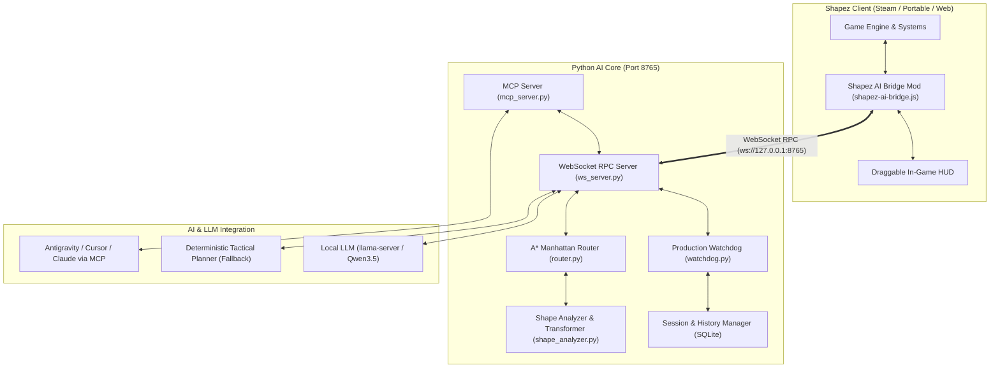

# Shapez AI: Autonomous Cognitive Factory Builder & Orchestrator

[](https://opensource.org/licenses/Apache-2.0)
[](https://www.python.org/)
[]()
[]()
[]()

> **Shapez AI** — полнофункциональная автономная когнитивная система управления, проектирования и самовосстановления фабрик для игры **Shapez**. Объединяет в себе игровой JS-мод с интерактивным внутриигровым HUD, высокоскоростной Python-оркестратор с детерминированным A*-маршрутизатором, Production Watchdog замкнутого цикла и встроенный MCP-сервер.

---

## 🚀 Ключевые возможности

- 🧠 **Автономный замкнутый цикл (Closed-Loop Autonomous Cycle):**
  $$\text{Планирование} \longrightarrow \text{Строительство} \longrightarrow \text{Проверка} \longrightarrow \text{Мониторинг} \longrightarrow \text{Диагностика} \longrightarrow \text{Исправление}$$
  ИИ не просто строит заводы, но непрерывно контролирует фактический приток фигур в Хаб с учетом расчётной задержки транспортировки. При возникновении заторов, поломок или ошибок линий система автоматически диагностирует и перестраивает поврежденный участок.

- 📐 **Эстетичная Манхэттенская архитектура (Smart Manhattan Routing):**
  - Детерминированный A*-маршрутизатор с динамическими штрафами за повороты для создания параллельных, аккуратных и компактных конвейерных шин.
  - Полноценная **4-сторонняя ориентация (`0°`, `90°`, `180°`, `270°`)** для всех станков (`Cutter`, `Painter`, `Rotater`, `Trash`).
  - **Автоматическая inline-вставка ротаторов:** система сама определяет необходимый поворот полуформ (`default` для 90° CW, `rotate180` для 180°, `ccw` для 270° CCW) и бесшовно врезает ротатор в магистраль.
  - Алгоритмическая поддержка многостадийных производственных ячеек: распил, окраска, смешивание красителей (Mixer) и подача в Хаб.

- 🎮 **Внутриигровой мост и HUD (In-Game Mod & Bridge):**
  - JS-мод `shapez-ai-bridge.js` подключается к игре через нативную систему хуков Shapez.
  - Высокоскоростной WebSocket RPC сервер (`ws://127.0.0.1:8765`) с поддержкой больших срезов карты (до 128 МБ).
  - Интерактивный перемещаемый (draggable) внутриигровой HUD: отображает текущий статус ИИ, уровень, цели, скорость доставки и мысли агента.
  - Поддержка мгновенной паузы ИИ (`Pause AI`), ручного управления и инспекции мира.

- 🛡️ **Production Watchdog & Self-Healing:**
  - Отслеживает прогресс выполнения целей уровня и пропускную способность линий в реальном времени.
  - Автоматически восстанавливает случайно разрушенные игроком конвейеры и станки за миллисекунды.
  - Распознает заторы, неверные фигуры и задержки транспортировки, запуская каскадное самоисправление.

- 🔌 **Встроенный MCP Сервер (Model Context Protocol):**
  - Модуль `mcp_server.py` предоставляет стандартные инструменты (`get_game_state`, `plan_and_build`, `inspect_tile`, `eval_code`) для прямого подключения к Google Antigravity, Cursor, Claude Desktop или локальным LLM.

---

## 🏛️ Архитектура системы



---

## 📦 Быстрый старт на новом компьютере

Система спроектирована так, чтобы разворачиваться на любом ПК за 1 минуту:

### 1. Клонирование репозитория

```bash
git clone https://github.com/QXIKmIJ/shapez-ai.git
cd shapez-ai
```

### 2. Установка зависимостей Python

Убедитесь, что установлен Python 3.10 или новее:

```bash
pip install -r requirements.txt
```

### 3. Установка игрового мода (1-Click)

Запустите скрипт установки:
- **Windows (CMD/Explorer):** Дважды кликните `install_mod.bat`
- **PowerShell:** `.\install_mod.ps1`

Скрипт автоматически скопирует `shapez-ai-bridge.js` в системную папку модов Shapez:
`%APPDATA%\shapez.io\mods\shapez-ai-bridge.js`.

> [!NOTE]
> Мод работает с **любой** версией Shapez: Steam-версией, itch.io, портативной или автономной сборкой.

### 4. Запуск оркестратора

- **Windows:** Дважды кликните `start_shapez_ai.bat` (или `.\start_shapez_ai.ps1`).
- Оркестратор поднимет WebSocket RPC мост на `ws://127.0.0.1:8765` и перейдет в режим ожидания игры.
- Если доступен локальный `llama-server`, он подключит нейросетевое планирование. В противном случае активируется высокоточный детерминированный тактический планировщик.

### 5. Запуск игры

Запустите Shapez (через Steam или локальный `shapez.exe`).
В правом верхнем углу появится HUD `Shapez AI: Connected`, и система автоматически приступит к анализу карты, месторождений и сборке фабрики!

---

## 🎛️ Интеграция с Model Context Protocol (MCP)

Shapez AI оснащен готовым MCP-сервером `shapez-ai/python/mcp_server.py`. Для подключения к внешним AI-агентам (Antigravity, Claude Desktop, Cursor) добавьте в ваш `mcp_config.json`:

```json
{
  "mcpServers": {
    "shapez-ai": {
      "command": "python",
      "args": [
        "c:/path/to/shapez-ai/shapez-ai/python/mcp_server.py"
      ]
    }
  }
}
```

### Доступные MCP-инструменты:
- `get_game_state` — Получение полного среза мира, уровня, целевой фигуры, прогресса и координат.
- `plan_and_build` — Автоматический расчет и мгновенное возведение оптимизированной производственной линии.
- `inspect_tile` — Инспекция содержимого клетки (здание, поворот, тип руды/краски).
- `eval_code` — Выполнение произвольного кода в контексте запущенной игры.

---

## 📁 Структура репозитория

```
shapez-ai/
├── shapez-ai/
│   ├── mod/
│   │   └── shapez-ai-bridge.js       # Внутриигровой JS-мод и draggable HUD
│   ├── python/
│   │   ├── bridge/
│   │   │   ├── protocol.py           # Pydantic модели протокола и строений
│   │   │   └── ws_server.py          # WebSocket RPC сервер с поддержкой 128MB payload
│   │   ├── llm/
│   │   │   ├── client.py             # Клиент LLM (llama-server / OpenAI API)
│   │   │   └── prompts.py            # Промпты архитектурного планирования
│   │   ├── mods/
│   │   │   └── mod_registry.py       # Реестр установленных сторонних модов игры
│   │   ├── planner/
│   │   │   ├── router.py             # Детерминированный A* Manhattan Router (4-way rotation)
│   │   │   └── shape_analyzer.py     # Анализатор и трансформер кодов фигур
│   │   ├── supervisor/
│   │   │   ├── tools.py              # Исполнитель supervisory-инструментов
│   │   │   └── watchdog.py           # Production Watchdog & Self-Healing система
│   │   ├── tests/                    # Полный набор Unit и E2E тестов
│   │   ├── main.py                   # Главный автономный цикл оркестратора
│   │   └── mcp_server.py             # Standalone MCP сервер
│   └── tests/
├── install_mod.bat                   # 1-Click установщик мода в %APPDATA%\shapez.io\mods
├── install_mod.ps1                   # PowerShell установщик мода
├── start_shapez_ai.bat               # Лаунчер оркестратора с автопроверками
├── start_shapez_ai.ps1               # PowerShell лаунчер оркестратора
├── requirements.txt                  # Python зависимости (aiohttp, pydantic, mcp)
├── README.md                         # Документация проекта
├── NOTICE                            # Уведомление об авторстве и патентной защите
├── LICENSE                           # Лицензия Apache License 2.0
└── .gitignore                        # Исключение бинарников, логов и дампов
```

---

## ⚖️ Лицензирование и авторские права

- **Автор и Главный Архитектор:** **QXIK_mIJ**
- **Лицензия:** [Apache License 2.0](LICENSE)

```
Copyright 2026 QXIK_mIJ

Licensed under the Apache License, Version 2.0 (the "License");
you may not use this file except in compliance with the License.
You may obtain a copy of the License at

    http://www.apache.org/licenses/LICENSE-2.0
```

> **Sovereign Attribution & Patent Protection:**
> Все архитектурные решения, алгоритмы трассировки, структуры когнитивного мониторинга и исходный код являются интеллектуальной собственностью и защищены патентом автора **QXIK_mIJ**. Любое частичное или полное использование в сторонних продуктах требует обязательного сохранения файлов `LICENSE` и `NOTICE` с явным указанием авторства.
