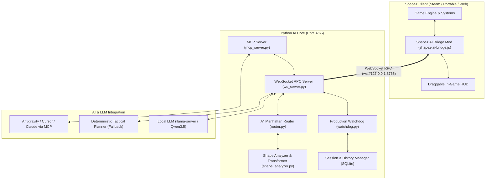

# Shapez AI: Autonomous Cognitive Factory Builder & Orchestrator

[](https://opensource.org/licenses/Apache-2.0)
[](https://www.python.org/)
[]()
[]()
[]()

> **Shapez AI** — автономная когнитивная система проектирования, оптимизации и самовосстановления производственных линий для игры **Shapez**. Объединяет внутриигровой JavaScript-мод с интерактивным HUD, высокопроизводительное Python-ядро с детерминированным A*-маршрутизатором, модуль отказоустойчивости Production Watchdog и сервер Model Context Protocol (MCP).

---

## Ключевые возможности

- **Автономный замкнутый цикл (Closed-Loop Autonomous Cycle):**
  $$\text{Планирование} \longrightarrow \text{Строительство} \longrightarrow \text{Проверка} \longrightarrow \text{Мониторинг} \longrightarrow \text{Диагностика} \longrightarrow \text{Исправление}$$
  Система непрерывно контролирует фактический приток целевых фигур в Хаб с учетом расчетной задержки транспортировки. При фиксации заторов, обрывов или снижения темпа производства автоматически выполняется диагностика и локальная перепрокладка проблемного участка.

- **Манхэттенская архитектура трассировки (Smart Manhattan Routing):**
  - Детерминированный A*-маршрутизатор с динамическими штрафами за повороты для формирования структурированных параллельных конвейерных шин.
  - Полноценная **4-сторонняя ориентация (`0°`, `90°`, `180°`, `270°`)** для всего технологического оборудования (`Cutter`, `Painter`, `Rotater`, `Trash`).
  - **Автоматическая inline-вставка ротаторов:** расчет требуемой пространственной ориентации полуформ (`default` — 90° CW, `rotate180` — 180°, `ccw` — 270° CCW) с автоматической врезкой ротатора в транспортную магистраль.
  - Поддержка многостадийных производственных комплексов: распил, колоризация, смешивание красителей (Mixer) и подача в целевые слоты Хаба.

- **Внутриигровой мост и интерфейс (In-Game Mod & Bridge):**
  - Мод `shapez-ai-bridge.js` подключается к игре через нативную архитектуру перехвата событий Shapez.
  - Двусторонний WebSocket RPC протокол (`ws://127.0.0.1:8765`) с поддержкой крупномасштабных срезов карты (буфер до 128 МБ).
  - Интерактивный перемещаемый HUD: отображает текущий статус агента, уровень, спецификацию целевой фигуры, производительность и расчетную траекторию действий.
  - Поддержка мгновенной приостановки работы (`Pause AI`), инспекции мира и ручной корректировки.

- **Подсистема мониторинга и самовосстановления (Production Watchdog):**
  - Непрерывный аудит темпа поставок и пропускной способности линий в реальном времени.
  - Автоматическое восстановление случайно удаленных компонентов за доли секунды.
  - Идентификация узких мест, некорректных компонентов и задержек с последующим автоматическим вызовом процедур самолечения.

- **Интеграция с Model Context Protocol (MCP):**
  - Модуль `mcp_server.py` предоставляет стандартный набор инструментов (`get_game_state`, `plan_and_build`, `inspect_tile`, `eval_code`) для прямого взаимодействия с Google Antigravity, Cursor, Claude Desktop или локальными большими языковыми моделями.

---

## Архитектура системы



---

## Развертывание и запуск на новом компьютере

Система подготовлена для быстрого автономного развертывания на любом рабочем месте:

### 1. Клонирование репозитория

```bash
git clone https://github.com/QXIKmIJ/shapez-ai.git
cd shapez-ai
```

### 2. Установка зависимостей Python

Требуется интерпретатор Python версии 3.10 или выше:

```bash
pip install -r requirements.txt
```

### 3. Установка игрового мода

Выполните скрипт инсталляции:
- **Командная строка Windows:** Запустите `install_mod.bat`
- **PowerShell:** `.\install_mod.ps1`

Скрипт выполнит копирование файла `shapez-ai-bridge.js` в системный каталог модов игры:
`%APPDATA%\shapez.io\mods\shapez-ai-bridge.js`.

> [!NOTE]
> Мод совместим со всеми официальными изданиями Shapez: Steam, itch.io, а также с автономными портативными сборками.

### 4. Запуск управляющего ядра

- Запустите `start_shapez_ai.bat` (или `.\start_shapez_ai.ps1`).
- Оркестратор инициирует WebSocket RPC сервер на порту 8765 и перейдет в режим ожидания подключения клиента игры.
- При наличии запущенного сервиса `llama-server` подключается нейросетевой модуль рассуждений. При его отсутствии оркестратор работает на базе встроенного детерминированного алгоритмического ядра.

### 5. Запуск игры

Запустите исполняемый файл Shapez (через клиент Steam или локальный `shapez.exe`).
В интерфейсе игры появится оверлей `Shapez AI: Connected`, после чего управляющий контур приступит к анализу топологии карты и строительству производства.

---

## Конфигурация Model Context Protocol (MCP)

Shapez AI содержит встроенный MCP-сервер `shapez-ai/python/mcp_server.py`. Для подключения к внешним средам разработки и ассистентам внесите следующую конфигурацию в файл `mcp_config.json`:

```json
{
  "mcpServers": {
    "shapez-ai": {
      "command": "python",
      "args": [
        "c:/path/to/shapez-ai/shapez-ai/python/mcp_server.py"
      ]
    }
  }
}
```

### Доступные MCP-инструменты:
- `get_game_state` — Получение полного структурного среза игрового мира, прогресса уровня и координат объектов.
- `plan_and_build` — Расчет и синхронное возведение производственной линии целевой фигуры.
- `inspect_tile` — Инспекция отдельной клетки координатной сетки (здание, поворот, параметры ресурса).
- `eval_code` — Выполнение инструкций в контексте запущенного игрового процесса.

---

## Структура репозитория

```
shapez-ai/
├── shapez-ai/
│   ├── mod/
│   │   └── shapez-ai-bridge.js       # Внутриигровой JavaScript-мод и оверлей управления
│   ├── python/
│   │   ├── bridge/
│   │   │   ├── protocol.py           # Модели структур данных и протокола обмена
│   │   │   └── ws_server.py          # WebSocket RPC сервер с поддержкой буфера до 128 МБ
│   │   ├── llm/
│   │   │   ├── client.py             # HTTP-клиент локальных и облачных нейросетевых моделей
│   │   │   └── prompts.py            # Инженерные спецификации и системные промпты
│   │   ├── mods/
│   │   │   └── mod_registry.py       # Реестр и спецификации совместимости сторонних модов
│   │   ├── planner/
│   │   │   ├── router.py             # Детерминированный A* маршрутизатор с 4-сторонней ориентацией
│   │   │   └── shape_analyzer.py     # Анализатор и декомпозитор геометрических кодов фигур
│   │   ├── supervisor/
│   │   │   ├── tools.py              # Исполнитель команд и служебных процедур
│   │   │   └── watchdog.py           # Подсистема контроля целостности и самовосстановления
│   │   ├── tests/                    # Набор модульных и интеграционных тестов
│   │   ├── main.py                   # Главный автономный цикл оркестратора
│   │   └── mcp_server.py             # Сервер интеграции по протоколу MCP
│   └── tests/
├── install_mod.bat                   # Пакетный установщик мода в %APPDATA%\shapez.io\mods
├── install_mod.ps1                   # PowerShell-скрипт установки мода
├── start_shapez_ai.bat               # Скрипт инициализации оркестратора с проверкой зависимостей
├── start_shapez_ai.ps1               # PowerShell-скрипт запуска оркестратора
├── requirements.txt                  # Спецификация зависимостей Python (aiohttp, pydantic, mcp)
├── README.md                         # Техническая документация проекта
├── NOTICE                            # Уведомление об авторстве и патентной защите
├── LICENSE                           # Текст лицензии Apache License 2.0
└── .gitignore                        # Правила исключения временных файлов и бинарных данных
```

---

## Лицензирование и авторские права

- **Автор и Главный Архитектор:** **QXIK_mIJ**
- **Лицензия:** [Apache License 2.0](LICENSE)

```
Copyright 2026 QXIK_mIJ

Licensed under the Apache License, Version 2.0 (the "License");
you may not use this file except in compliance with the License.
You may obtain a copy of the License at

    http://www.apache.org/licenses/LICENSE-2.0
```

> **Sovereign Attribution & Patent Protection:**
> Все архитектурные решения, алгоритмы трассировки, структуры когнитивного мониторинга и исходный код защищены патентом автора **QXIK_mIJ**. Любое частичное или полное использование в сторонних продуктах требует обязательного сохранения файлов `LICENSE` и `NOTICE` с сохранением исходного авторства.
